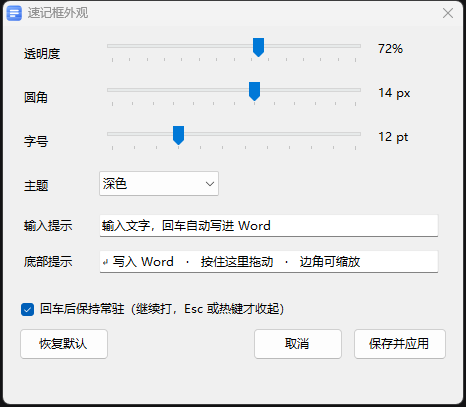

# WordNote

WordNote 是一个常驻 Windows 托盘的小工具：用全局热键把屏幕截图和随手写的文字直接插入 Word 文档的光标处。它面向「一边看视频一边记笔记」的场景——记一张图、记一句话，都不用切窗口、不用手动粘贴、不用敲回车。

## 功能特性

- **区域截图，一次框选长期有效。** 第一次按 `Ctrl+Alt+S` 框出视频画面，之后同一个热键直接截取该区域，图片落在 Word 光标处并自动换行。
- **速记框。** `Ctrl+Alt+N` 弹出一个半透明小面板，输入文字后回车即写入 Word，焦点自动回到视频。默认写完后常驻，可连续记多条，按 `Esc` 收起。
- **速记框可拖动、可缩放、会记住位置。** 拖动整块面板或右下角的缩放徽标即可调整，松手就把位置和大小写入配置文件，下次弹在同一处；拖出屏幕会被自动夹回可见区域。
- **中文输入法可用。** 速记框是独立的前台小窗，候选框跟随输入框；选字过程中的回车交给输入法，不会误提交。
- **两种插入通道。** 优先走 Word COM 自动化：通过 MSAA 原生对象模型直接连上「你指定的那扇 Word 窗口」，不依赖运行对象表（ROT），不会把内容写进别的 Word 实例；插入时按版心宽度缩放图片，全程不碰剪贴板、不模拟按键。连不上时才退回「剪贴板 + Ctrl+V」通道。
- **可以指定插入目标。** 同时开着好几个 Word 文档时，用托盘的「选择插入目标的 Word 窗口…」挑选目标窗口，选择会存进 `WordNote.ini`；该窗口关闭后程序会按标题自动找回，再找不到就退回自动挑选「可见且有标题」的那个窗口。
- **播放控制与窗口切换。** `Ctrl+Alt+Space` 全局播放/暂停，`Ctrl+Alt+W` 在 Word 与视频窗口之间来回切。
- **自动插入开关。** `Ctrl+Alt+G` 可以暂停「截图自动进 Word」，只在需要时手动截一张。
- **剪贴板图片去重。** `PrintScreen`、`Win+Shift+S` 常把同一张图往剪贴板写两次，程序按内容指纹在短时间内跳过重复项，不会一次插两张。
- **单文件、零依赖。** 全部逻辑在一个 C# 源文件里，用系统自带的 `csc.exe` 编译，不需要 NuGet，也不需要额外安装运行时（依赖 Windows 自带的 .NET Framework 4.x）。
- **本地配置与日志。** `WordNote.ini` 和 `WordNote.log` 都在 exe 同目录，出问题时可以直接看日志，确认每次走的是哪条插入通道。

## 界面

速记框外观设置（透明度、圆角、字号、主题、提示文字、是否常驻）：

## 安装

### 方式一：使用安装包

从 [Releases](../../releases) 下载 `WordNote-一键安装包.zip`，解压到任意位置。

1. 解压后会看到安装包文件夹。
2. 双击 `一键安装.cmd`。
3. 看到「安装完成」后，打开 Word 笔记文档，按一次 `Ctrl+Alt+S` 框选视频区域（只需这一次）。

程序会装到 `%LOCALAPPDATA%\WordNote`，并创建桌面和开始菜单快捷方式。配置文件 `WordNote.ini` 就在该目录，重新安装时会保留原有配置。

- **开机自启（可选，默认关闭）**：运行 `启用开机自启.cmd`；取消则运行 `停用开机自启.cmd`。
- **升级**：重新运行一次 `一键安装.cmd`，程序文件被替换，配置保留。
- **卸载**：运行 `卸载.cmd`，结束时可以选择是否保留配置文件。

### 方式二：从源码运行

1. 确认系统已启用 .NET Framework 4.x（Windows 10/11 自带）。
2. 运行 `build.cmd`，在同目录得到 `WordNote.exe`。
3. 双击 `WordNote.exe`，托盘出现图标即表示启动。

**关于系统影响。** 程序不联网、不采集遥测、不请求管理员权限，也不写注册表。安装包只做「复制文件 + 放置快捷方式」，开机自启通过在「启动」文件夹添加快捷方式实现；全部配置只保存在 exe 同目录的 `WordNote.ini`。

## 热键

| 热键 | 作用 |
| --- | --- |
| `Ctrl+Alt+S` | 截图并插入 Word 光标处，随后换行；首次使用先框选区域 |
| `Ctrl+Alt+N` | 打开速记框；回车把文字写进 Word，默认写完框仍常驻可接着记，`Esc` 收起 |
| `Ctrl+Alt+Shift+S` | 重新框选截取区域 |
| `Ctrl+Alt+Space` | 播放 / 暂停 |
| `Ctrl+Alt+W` | 在 Word 与视频窗口之间切换 |
| `Ctrl+Alt+G` | 开 / 关自动插入 |
| 托盘图标双击 | 等同按一次 `Ctrl+Alt+S` |
| 托盘右键 | 现在截一张 / 重新框选 / 速记框外观 / **选择插入目标的 Word 窗口** / 打开配置 / 退出 |

所有热键都可以在 `WordNote.ini` 中修改，退出程序后重新启动生效。

## 配置说明

`WordNote.ini` 位于 exe 同目录，首次运行时自动生成；手工修改后需要重启程序。常用的键如下：

| 键 | 含义 |
| --- | --- |
| `snip` / `reselect` / `note` / `play_pause` / `focus` / `auto` | 六个全局热键，写法如 `Ctrl+Alt+S`、`Shift+F8`、`Alt+Space` |
| `auto_mode` | `1` 表示任何截图都自动插入；`0` 表示只响应 `Ctrl+Alt+S` |
| `lines_after` | 图片之后空几行，默认 `1` |
| `image_width_percent` | COM 通道：图片占版心宽度的百分比，默认 `100` |
| `paste_width_px` | 备用通道：图片缩放到多少像素宽，默认 `500` |
| `region` | 记住的截取区域，由程序自动写入 |
| `note_x` / `note_y` | 速记框上次的位置，`-1` 表示自动居中 |
| `note_w` / `note_h` | 速记框上次的大小，`-1` 表示使用默认尺寸 |
| `note_opacity` / `note_radius` / `note_font` | 透明度（30%–100%）/ 圆角（0–24 px）/ 字号（9–20 pt） |
| `note_theme` / `note_cue` / `note_hint` | 主题（`dark` / `light`）/ 输入框提示文字 / 底部提示文字 |
| `note_stay` | `1` 回车后保持常驻（默认），`0` 写完自动收起 |
| `word_hwnd` / `word_title` | 由「选择插入目标的 Word 窗口」写入；`0` 表示自动挑选 |
| `word_progid` / `word_class` | 仅在使用 WPS 时需要改（如 `KWPS.Application`），Microsoft Word 无需改动 |

速记框的外观（透明度、圆角、字号、主题、提示文字、是否常驻）也可以通过托盘右键的「速记框外观…」调整，拖动滑块即可实时预览，保存后写入 ini。透明度建议保持在 55%–75%。

## 已知限制

- **输入法候选框必须跟随焦点窗口。** 因此无法实现「视频窗口保持焦点、按键打出的字自己飞进 Word」。要么让 Word 保持焦点，要么通过速记框中转——速记框是前台窗口，输入法工作正常，回车后焦点再交还。
- **备用通道会占用剪贴板。** 走「剪贴板 + Ctrl+V」时，原来复制的内容会被替换。
- **不支持把 Word 里已有的图片重新插回文档。** 剪贴板所有者是 Word 时，程序会跳过。
- **同一时间只能运行一个实例。** 两个实例会争抢同一批全局热键，后启动的那个注册会全部失败。
- **备用通道要求 Word 能切换到前台。** 如果 Word 被其他窗口遮挡且切不到前台，程序会直接提示失败，不会把按键发到别的窗口。

## 常见问题

**按热键没反应。** 先看 `WordNote.log`。最常见的原因是组合键被其他软件占用（日志里对应记录为失败），改 ini 换一个组合即可；同时确认没有同时运行两份程序。

**截图有竖条纹或黑块。** 这是系统抓屏抓到了 GPU 合成中的画面（视频叠加层、硬件加速窗口），不是程序绘制的问题。用 `Ctrl+Alt+S` 截图（程序抓屏前会先收起速记框），或者先按 `Esc` 关掉速记框再按 `PrintScreen`。

**提示「插入失败：Word 没打开」或「Word 没能切到前台」。** 前者要先打开 Word 并确保里面有文档；后者先用 `Ctrl+Alt+W` 或 `Alt+Tab` 切到 Word，再按热键。

**插入的图片太大或太小。** 调 `paste_width_px`（备用通道，默认 500 像素宽）或 `image_width_percent`（COM 通道，默认占版心 100%）。

**速记框拖不动或位置记不住。** 现在整块面板都可以拖动，缩放请拖右下角徽标；拖到屏幕边缘外会自动夹回屏幕内，位置和大小都会写入 `note_x` / `note_y` / `note_w` / `note_h`。

## 从源码构建

构建只依赖 Windows 和系统自带的 .NET Framework 4.x，不需要 Visual Studio、NuGet 或任何第三方包。

- `build.cmd` 会定位 `%WINDIR%\Microsoft.NET\Framework64\v4.0.30319\csc.exe`（找不到时回退到 32 位路径），以 `/target:winexe /platform:anycpu` 编译 `WordNote.cs`，引用 `System.dll`、`System.Windows.Forms.dll`、`System.Drawing.dll`、`Microsoft.CSharp.dll`。
- 产物是同目录下的单文件 `WordNote.exe`。如果 `wordnote.ico` 存在，会被编译进 exe，用于托盘、任务栏和窗口图标。
- 源码中没有任何网络请求、注册表访问或提权声明，编译出的程序以普通用户权限运行。
- 配置文件和日志不在仓库里，而是在首次运行时于 exe 同目录生成。

## 许可

本项目以 MIT 许可证发布。你可以自由使用、修改和再分发，包括商业用途，条件是保留版权声明与许可声明；软件按「原样」提供，不附带任何担保。

## English summary

WordNote is a Windows tray utility that inserts screenshots and quick notes straight into Microsoft Word at the caret, built for taking notes while watching video.
Global hotkeys cover region capture, a floating note box, play/pause, and switching between Word and the video window.
Insertion prefers Word COM automation and falls back to clipboard + Ctrl+V, which temporarily replaces the clipboard contents.
It is a single C# file compiled with the bundled `csc.exe`; settings live in `WordNote.ini` next to the executable, and no administrator rights are needed.
Released under the MIT license.
